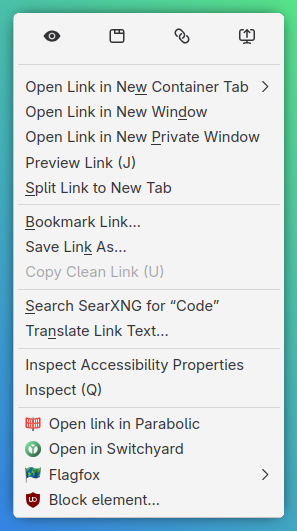

# Zen URL Context Quick Actions

A local Zen Browser stylesheet mod that presents four existing link context-menu actions as an icon row:

1. Open in Glance
2. Open in New Tab
3. Copy Link
4. Send Link to Device

The mod styles and positions Zen's native menu entries in a reserved strip at the top of the link context menu. Their built-in commands and the Send to Device submenu remain in charge of behavior. It does not add JavaScript or create replacement actions.



## Compatibility

Tested on **Linux with Zen Browser 1.23.4b**. Other platforms and versions have not been verified. Menu sizing and colors depend on your platform and theme.

## Install locally

Requires Python 3.10 or newer and GNU Make.

### Find your profile directory

1. Open `about:support` in Zen's address bar.
2. Under **Application Basics**, find **Profile Directory** (or **Profile Folder**) and click **Open Directory** / **Open Folder**.
3. Copy the full path from your file manager. Use the profile directory itself, not its `chrome` subdirectory.

Alternatively, open `about:profiles` and use the **Root Directory** of the profile marked as currently in use, rather than its Local Directory.

### Install and remove

From this repository directory, supply your profile path explicitly (quotes are important if it contains spaces):

```sh
make install PROFILE="/full/path/to/your/zen/profile"
```

There is no default or hard-coded profile. Both install and uninstall require `PROFILE=...`.

The installer copies `zen-url-context.css` into the profile's `chrome` directory and adds a marked import to `userChrome.css`. It also sets `toolkit.legacyUserProfileCustomizations.stylesheets` to `true` via a reversible managed block in `user.js`. Restart Zen for the setting and stylesheet to take effect.

Uninstall with:

```sh
make uninstall PROFILE="/full/path/to/your/zen/profile"
```

Use the same profile path for uninstall. Uninstall removes only this mod's marked import, managed preference block, and stylesheet copy; unrelated profile customizations are kept. The stylesheet-loading preference may remain enabled in Zen after the managed block is removed; you can reset it in `about:config` if you no longer use other profile stylesheets.

After editing the mod, run `make install PROFILE="/full/path/to/your/zen/profile"` again and restart Zen to load the updated copy.

## Testing

Open a webpage, right-click a link, and check that the four icon buttons appear side by side at the top of the context menu. The Send to Device button should open the native device submenu. On systems without an available Firefox Sync device, Zen may hide that action.

Zen menu internals can change between releases. If an action disappears or the row layout breaks after an update, inspect the live IDs in the Browser Toolbox and adjust the selectors in `zen-url-context.css`.

## Publishing

This folder is the source package. Publishing requires the current Zen Mods submission process; the previously documented `zen-browser/theme-store` repository was archived in July 2026, so its old issue-template instructions may not be usable. The stylesheet can still be shared directly or hosted from a maintained repository.

## License

[MIT](LICENSE).
